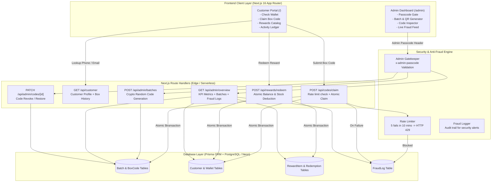
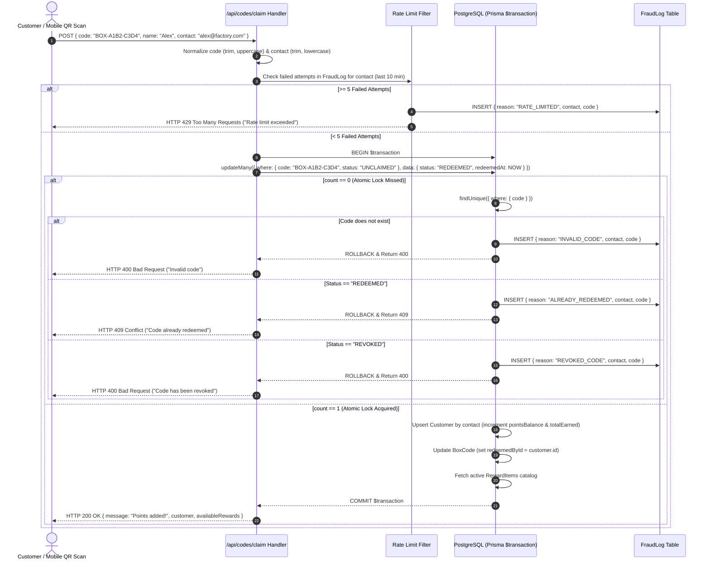

# System Architecture & Technical Specifications

## Customer Loyalty Rewards System (EcoRewards™)

This document provides a comprehensive overview of the architecture, data models, security boundaries, and runtime execution flow for the Customer Loyalty Rewards System designed for factories selling physical goods in sealed packaging.

---

## 1. Technical Stack & Design Rationales

| Layer | Technology | Key Decision Rationale |
| :--- | :--- | :--- |
| **Framework** | **Next.js 16+ (App Router)** | Full-stack unified TypeScript framework providing Web-standard `NextRequest` and `NextResponse` route handlers, automatic route code-splitting, and streaming UI rendering. |
| **Language** | **TypeScript 5.x** | End-to-end type safety spanning Prisma schemas, API request/response contracts, and React UI components. Prevents type errors at compile time. |
| **Styling** | **Tailwind CSS v4 + PostCSS** | Utility-first CSS pipeline using `@tailwindcss/postcss`. Zero runtime CSS overhead, built-in `@media print` support for factory box-insert sticker sheets, and consistent **Crisp White & Forest Green Eco-Packaging** theming. |
| **Database & ORM** | **Prisma ORM 6.x + PostgreSQL (Neon Serverless)** | Strongly-typed schema definition, automated schema migrations (`prisma db push`), connection pooling, and transactional integrity (`prisma.$transaction`) with Neon PostgreSQL. |
| **Admin Security** | **Stateless Header Passcode (`x-admin-passcode`)** | Eliminates session databases, cookie sync overhead, and stateful authentication servers. Operates natively in serverless edge environments on Vercel while securing administrative routes against unauthorized operations. |

---

## 2. Complete Data Model Specification

The Prisma schema is defined at [prisma/schema.prisma](file:///c:/Users/ASUS/Desktop/ass2/prisma/schema.prisma). All entity primary keys use UUID strings for globally unique, non-enumerable identity.

```prisma
datasource db {
  provider = "postgresql"
  url      = env("DATABASE_URL")
}

generator client {
  provider = "prisma-client-js"
}
```

### Models & Schema Detail

#### 1. `Batch`
Represents a production run of physical boxed items generated by the factory administrator.
- `id` (String, `@id @default(uuid())`): Unique batch identifier.
- `name` (String): Factory production lot name (e.g., `BATCH-2026-ALPHA`).
- `productName` (String): Commercial name of the physical product (e.g., `Eco-Insulated Steel Flask 750ml`).
- `pointsPerCode` (Int): Loyalty points awarded per valid box code claimed.
- `quantity` (Int): Total codes issued in this production lot.
- `createdAt` (DateTime, `@default(now())`): Timestamp of generation.
- **Relations**: `codes BoxCode[]` (Cascade delete on batch removal).

#### 2. `BoxCode`
Represents an individual, single-use 12-character code printed inside a physical package.
- `id` (String, `@id @default(uuid())`): Unique record ID.
- `code` (String, `@unique`): Cryptographic unique string in format `BOX-XXXX-XXXX`.
- `batchId` (String): Foreign key referencing `Batch.id`.
- `status` (String, `@default("UNCLAIMED")`): State flag (`"UNCLAIMED"` | `"REDEEMED"` | `"REVOKED"`).
- `redeemedById` (String?, nullable): Foreign key referencing `Customer.id` once claimed.
- `redeemedAt` (DateTime?, nullable): Timestamp of claim.
- `createdAt` (DateTime, `@default(now())`): Timestamp of code generation.
- **Indexes**: `@@index([status])` for accelerated status and availability queries.

#### 3. `Customer`
Represents an end-user who has registered or claimed points.
- `id` (String, `@id @default(uuid())`): Unique customer profile ID.
- `name` (String): Customer display name.
- `contact` (String, `@unique`): Normalized email address or telephone number.
- `pointsBalance` (Int, `@default(0)`): Current redeemable points balance.
- `totalEarned` (Int, `@default(0)`): Cumulative lifetime points earned.
- `createdAt` (DateTime, `@default(now())`): Profile creation timestamp.
- **Relations**: `claimedBoxes BoxCode[]`, `redemptions RewardRedemption[]`.

#### 4. `RewardItem`
Catalog item that can be redeemed using accumulated loyalty points.
- `id` (String, `@id @default(uuid())`): Unique item ID.
- `title` (String): Reward title (e.g., `Factory Branded Steel Thermos`).
- `description` (String): Detailed reward item description.
- `pointsCost` (Int): Points required to redeem.
- `stock` (Int): Current physical inventory remaining.
- `active` (Boolean, `@default(true)`): Active catalog visibility flag.
- **Relations**: `redemptions RewardRedemption[]`.

#### 5. `RewardRedemption`
Audit record created whenever a customer redeems a reward item.
- `id` (String, `@id @default(uuid())`): Unique redemption transaction ID.
- `customerId` (String): Foreign key referencing `Customer.id`.
- `rewardId` (String): Foreign key referencing `RewardItem.id`.
- `pointsSpent` (Int): Snapshot of points spent at the time of redemption.
- `status` (String, `@default("PENDING")`): Order fulfillment status (`"PENDING"` | `"FULFILLED"`).
- `createdAt` (DateTime, `@default(now())`): Timestamp of redemption.
- **Indexes**: `@@index([customerId])`, `@@index([rewardId])`.

#### 6. `FraudLog`
Real-time security ledger capturing all invalid, duplicate, revoked, or rate-limited claim attempts.
- `id` (String, `@id @default(uuid())`): Unique log entry ID.
- `attemptedCode` (String): Raw or normalized code string entered by the user.
- `contact` (String): Normalized contact info associated with the attempt.
- `reason` (String): Enumerated security reason:
  - `"INVALID_CODE"`: Non-existent code string.
  - `"ALREADY_REDEEMED"`: Code was previously redeemed by another or the same customer.
  - `"REVOKED_CODE"`: Factory owner revoked this code prior to claim.
  - `"RATE_LIMITED"`: Contact triggered the 5-failed-attempts-in-10-minutes threshold.
- `createdAt` (DateTime, `@default(now())`): Timestamp of the attempted fraud.
- **Indexes**: `@@index([contact, createdAt])` for rapid rate-limit window computation.

---

## 3. Architecture Diagrams

### Diagram 1: System Architecture & Data Flow



---

### Diagram 2: Atomic Code Claim & Fraud Prevention Sequence



---

## 4. API Endpoint Contract Directory

| Route | Method | Auth | Body / Params | Expected Response | Error Responses |
| :--- | :---: | :---: | :--- | :--- | :--- |
| `/api/codes/claim` | `POST` | Public | `{ code, name, contact }` | `200 OK`: Updated customer balance + available rewards | `400` (Missing fields, invalid/revoked code), `409` (Already redeemed), `429` (Rate limited) |
| `/api/customer` | `GET` | Public | `?contact=...` | `200 OK`: Profile, claimed boxes, rewards catalog, redemptions | `400` (Missing contact), `404` (Customer not found) |
| `/api/rewards` | `GET` | Public | None | `200 OK`: Active `RewardItem` catalog | `500` (Server error) |
| `/api/rewards/redeem` | `POST` | Public | `{ contact \| customerId, rewardId }` | `200 OK`: Redemption record + updated customer balance | `400` (Insufficient points, out of stock), `404` (Item/customer not found) |
| `/api/admin/batches` | `POST` | Passcode | `{ name, productName, pointsPerCode, quantity }` | `201 Created`: Batch record + sample generated codes | `401` (Unauthorized), `400` (Invalid payload) |
| `/api/admin/overview` | `GET` | Passcode | None | `200 OK`: Metrics, batches list with codes, recent redemptions, fraud logs | `401` (Unauthorized) |
| `/api/admin/codes/[id]`| `PATCH` | Passcode | `{ action: "REVOKE" \| "UNREVOKE" }` | `200 OK`: Updated code record with new status | `401` (Unauthorized), `404` (Code not found) |
